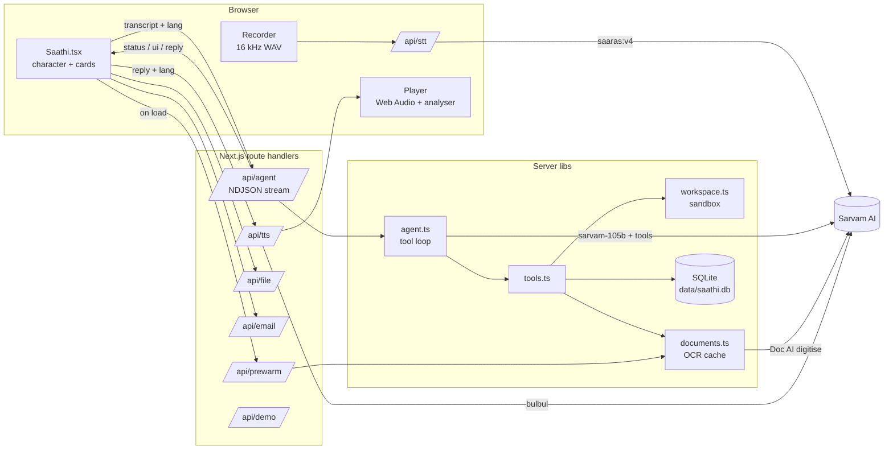

# Architecture

## Overview



One turn:

1. **Capture.** Holding space/mic records raw PCM via Web Audio, downsampled to
   16 kHz mono WAV in the browser (Sarvam's REST STT documents WAV; we avoid
   relying on WebM). Max 29 s, matching the 30 s REST limit.
2. **Transcribe.** `POST /api/stt` → Sarvam `speech-to-text` returns the
   transcript and the detected language code.
3. **Think + act.** `POST /api/agent` runs the tool loop server-side and
   streams NDJSON back: `status` lines ("Reading rent-agreement…"), `ui` events
   (cards), and finally one `reply`. Cards appear *while* the model is still
   working, so the screen is never idle.
4. **Speak.** `POST /api/tts` with the reply and the language detected from
   the reply's script → base64 WAV → played through an `AnalyserNode` whose
   level drives the character's mouth.

Typed input skips step 1–2. Pressing space while Saathi is talking stops the
audio (barge-in); a new question aborts any turn still streaming.

## File layout

```
src/
  app/
    page.tsx                 renders <Saathi/>
    api/
      agent/route.ts         tool loop → NDJSON stream
      stt/route.ts           audio → transcript
      tts/route.ts           text → base64 WAV
      file/route.ts          raw workspace file for previews (sandboxed)
      upload/route.ts        drag-and-drop → workspace/Uploads/
      email/route.ts         Send/Discard buttons on the draft card
      prewarm/route.ts       background OCR of all docs (?status = progress only)
      demo/route.ts          scripted no-LLM turn for /?demo
  components/
    Saathi.tsx               page state machine, dock, layout, preview modal
    Character.tsx            animated SVG character
    Cards.tsx                one component per UiEvent kind
  lib/
    types.ts                 shared types (UiEvent, AgentChunk, Email, ...)
    sarvam.ts                thin REST client: chat, STT, TTS, Doc AI
    agent.ts                 system prompt + tool-calling loop
    tools.ts                 tool specs and executors
    workspace.ts             path sandbox, listing, reading, writing
    documents.ts             OCR with SQLite cache + in-flight dedupe + prewarm
    db.ts                    SQLite schema, seed data, row mappers
    lang.ts                  script-based language detection for TTS
    client/audio.ts          Recorder (WAV encoder) and Player (analyser)
scripts/seed-workspace.mjs   demo files; renders "scanned" PDFs with ImageMagick
workspace/                   the sandbox the assistant sees
data/saathi.db               SQLite (gitignored)
```

## Data model (SQLite)

Uses Node's built-in `node:sqlite` (`DatabaseSync`) — no native dependency to
compile. The connection is cached on `globalThis` so dev hot reloads don't open
new handles. Seed rows are inserted the first time the DB is created; event
dates are relative to "now" so the calendar always looks current.

| Table | Purpose |
|---|---|
| `contacts` | Mock address book (landlord, manager, Maa, …) |
| `emails` | Mock mailbox. `folder` is `inbox` \| `draft` \| `sent`; attachments are a JSON array of workspace paths |
| `events` | Mock calendar. `start`/`end` are local `YYYY-MM-DDTHH:MM` strings |
| `memories` | Long-term facts from the `remember` tool, injected into every system prompt |
| `doc_cache` | Sarvam Vision OCR output keyed by `(path, mtime)` |

The "online services" are deliberately mocks behind the same tool interface a
real Gmail/Calendar integration would use; swapping in real APIs only touches
the executors in `tools.ts` and `api/email`.

## Document pipeline

`read_file` on a PDF/PNG/JPG calls `readDocument()`:

1. Look up `doc_cache` by `(path, mtime)`. Hit → return instantly.
2. Otherwise check an in-flight map (so a prewarm job and a user request for
   the same file share one Doc AI job).
3. Run Doc AI `digitise` (`output_format=md`), poll status, download the ZIP,
   extract the `.md`, store it in `doc_cache`.

Doc AI is a job + polling API and takes several seconds, so the page calls
`/api/prewarm` on load: all uncached documents are OCR'd sequentially in the
background, and the header chip shows progress. By the time you ask about a
document it's usually cached. If it isn't, the tool first emits a `loading`
file card (scanning animation) and replaces it with the same card id once the
text is ready.

## Security boundaries

- **Filesystem sandbox.** Every path goes through `resolveSafe()`, which
  resolves against `WORKSPACE_DIR` and rejects anything outside it (`../`,
  absolute paths). `/api/file` uses the same check. Writes are limited to text
  extensions, so the model can't overwrite PDFs or images.
- **Email.** The model can only *draft*. Sending requires either a click on the
  draft card or an explicit spoken confirmation, which the system prompt and
  the `send_email` description both require. All mail is local mock data.
- **Secrets.** The Sarvam key lives only on the server (`.env.local`); the
  browser talks exclusively to our route handlers.
- This is a single-user local demo: there is no auth, and it should not be
  exposed on a public network as-is.
